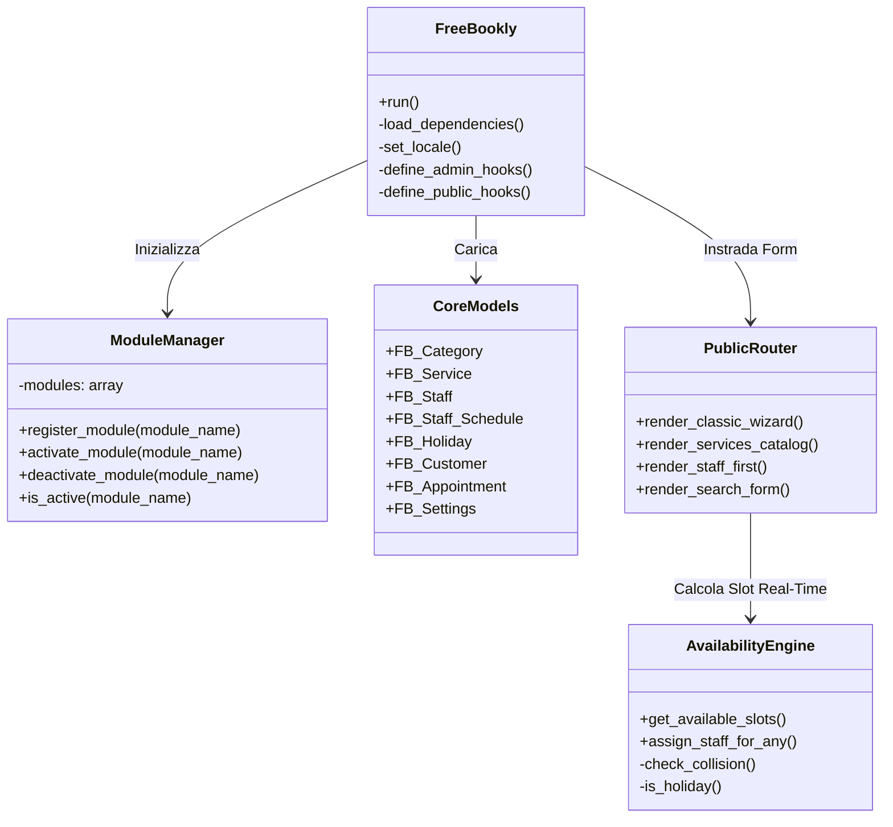
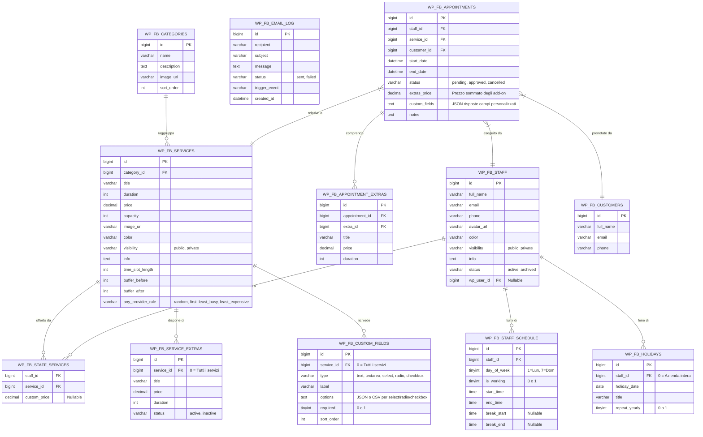

# Architettura "Free Bookly"

**Autore:** Stefano Lenzi  
**Licenza:** GPL-2.0+  
**Versione:** 1.4.0 (Open Source)

Questo documento descrive l'architettura tecnica del plugin, progettata secondo i principi di massima modularità, assenza di dipendenze pesanti, testabilità e parità funzionale completa con Bookly Pro.

---

## 1. Architettura Generale a Moduli (Core + Extensions)

Il plugin adotta un pattern MVC modulare integrato con WordPress Hooks:

---

## 2. Schema del Database Relazionale (DB Version 1.4.0)

Tutte le entità sono gestite con 11 tabelle dedicate SQL, indicizzate per garantire velocità istantanea anche con grandi volumi di dati:

---

## 3. Motore di Disponibilità & Collision Engine

La classe [`FB_Availability`](file:///c:/Users/stefy/Progetti/free-bookly/includes/class-fb-availability.php) esegue il calcolo in tempo reale secondo il seguente flusso:
1. **Controllo Festività (Holidays):**
   * Se la data è registrata come festività aziendale (`staff_id = 0`) o giorno di ferie del collaboratore, la giornata è considerata chiusa e restituisce 0 slot.
   * Supporta ricorrenza annuale automatica (`repeat_yearly = 1`).
2. **Turno di Lavoro & Pause (Schedules & Breaks):**
   * Recupera gli orari del collaboratore da `wp_fb_staff_schedule`.
   * Se non impostati, eredita automaticamente gli orari aziendali predefiniti (`FB_Settings::get_company_working_hours()`).
3. **Calcolo Dinamico della Durata Effettiva con Add-ons:**
   * Durata slot richiesta = `base_service_duration + sum(extras_duration)`.
   * Il motore verifica la disponibilità per l'intero intervallo espanso, evitando sovrapposizioni su turni di chiusura o pause intermedie.
4. **Passo Temporale di Avanzamento (Time Slot Length):**
   * Determinato dal servizio (`time_slot_length`) oppure dall'impostazione globale (`fb_time_slot_length`, default 15 min).
5. **Verifica Collisioni con Buffer Times:**
   * Per ogni slot potenziale `[start, end]`:
     * Durata richiesta = `effettiva_durata + buffer_after`.
     * Margine iniziale = `start - buffer_before`.
     * Verifica che l'intervallo non si sovrapponga a pause di turno o appuntamenti già confermati/in attesa.
6. **Regole Assegnazione "Qualsiasi Collaboratore" (Any Provider):**
   * `random`: Selezione casuale uniforme tra tutti i collaboratori liberi.
   * `first`: Primo collaboratore in ordine di apparizione.
   * `least_busy`: Collaboratore con minor numero di appuntamenti nella giornata prescelta (bilanciamento del carico).
   * `least_expensive`: Collaboratore che offre la tariffa più conveniente per il servizio.

---

## 4. Frontend Multi-Form & Vanilla JS Engine

Tutti i form sono serviti dal file [`public/js/free-bookly-wizard.js`](file:///c:/Users/stefy/Progetti/free-bookly/public/js/free-bookly-wizard.js), scritto in puro Vanilla JavaScript:
* **Classic Wizard:** Navigazione a schede progressiva con pre-filtro categorie, selezione extra opzionali in Step 1, selezione slot in Step 2, compilazione campi personalizzati con validazione obbligatorietà in Step 3 e riepilogo dettagliato in Step 4.
* **Services Catalog:** Griglia responsive a schede con filtraggio pillole e modale dinamico integrato con supporto add-ons.
* **Staff-First:** Vetrina del personale con avatar, colori distintivi e apertura modale con collaboratore pre-assegnato.
* **Search Form:** Ricerca per data e fascia oraria (*Mattina*, *Pomeriggio*, *Sera*) con restituzione immediata degli slot.

---

## 5. Modulo 1: Notifiche Email & Calendario (.ics) RFC 5545

Il modulo [`FB_Email_Notifications`](file:///c:/Users/stefy/Progetti/free-bookly/includes/modules/class-fb-email-notifications.php) gestisce il ciclo completo delle comunicazioni transazionali:
* **Trigger Automatici:**
  * Creazione appuntamento (notifica cliente + notifica staff/admin).
  * Approvazione appuntamento (`status = 'approved'`).
  * Cancellazione appuntamento (`status = 'cancelled'`).
* **Generatore ICS Nativo ([`FB_ICS`](file:///c:/Users/stefy/Progetti/free-bookly/includes/class-fb-ics.php)):**
  * Conforme alle specifiche RFC 5545 (line folding a 75 ottetti, caratteri di escape `\,`, `\;`, `\n`, timestamp UTC `Z`, UID univoco, allarme promemoria -15m).
  * Genera file `.ics` temporaneo allegato all'email per l'aggiunta istantanea su Google Calendar, Apple Calendar e Outlook.
* **Template & Segnaposto Dinamici:**
  * `{customer_name}`, `{service_name}`, `{service_extras}`, `{custom_fields}`, `{staff_name}`, `{appointment_date}`, `{appointment_time}`, `{duration}`, `{total_price}`, `{company_name}`, `{company_phone}`.
* **Logging & Tracciabilità:**
  * Ogni email inviata viene archiviata nella tabella `wp_fb_email_log`, consultabile dall'amministratore con stato (*sent*/*failed*) e data/ora.

---

## 6. Modulo 4: Servizi Extra & Campi Personalizzati

### 6.1 Servizi Extra (Add-ons)
* Gestiti dalla classe [`FB_Service_Extra`](file:///c:/Users/stefy/Progetti/free-bookly/includes/class-fb-service-extra.php).
* Supportano prezzo addizionale (€) e durata aggiuntiva (minuti).
* Possono essere globali (tutti i servizi) o dedicati a un servizio specifico.
* Nel frontend vengono renderizzati in tempo reale come checkbox reattivi che aggiornano sia il prezzo totale che la disponibilità oraria del calendario.

### 6.2 Campi Personalizzati (Custom Fields)
* Gestiti dalla classe [`FB_Custom_Field`](file:///c:/Users/stefy/Progetti/free-bookly/includes/class-fb-custom-field.php).
* Tipologie supportate: `text`, `textarea`, `select`, `radio`, `checkbox`.
* Supporto flag obbligatorio (`required`) con validazione client-side e server-side.
* I valori compilati vengono serializzati in formato JSON nella colonna `wp_fb_appointments.custom_fields` e visualizzati nel calendario admin e nelle notifiche email.
