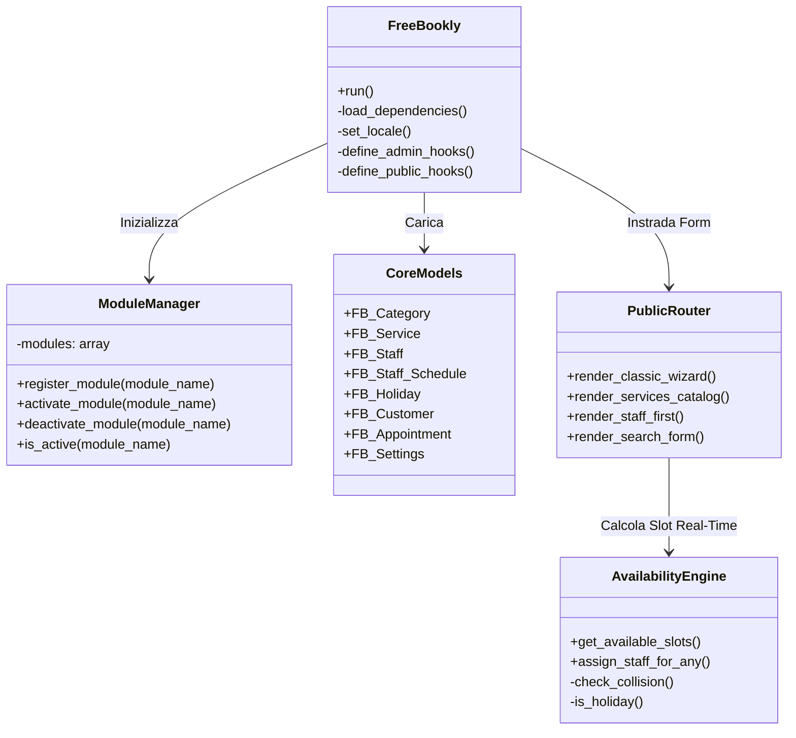
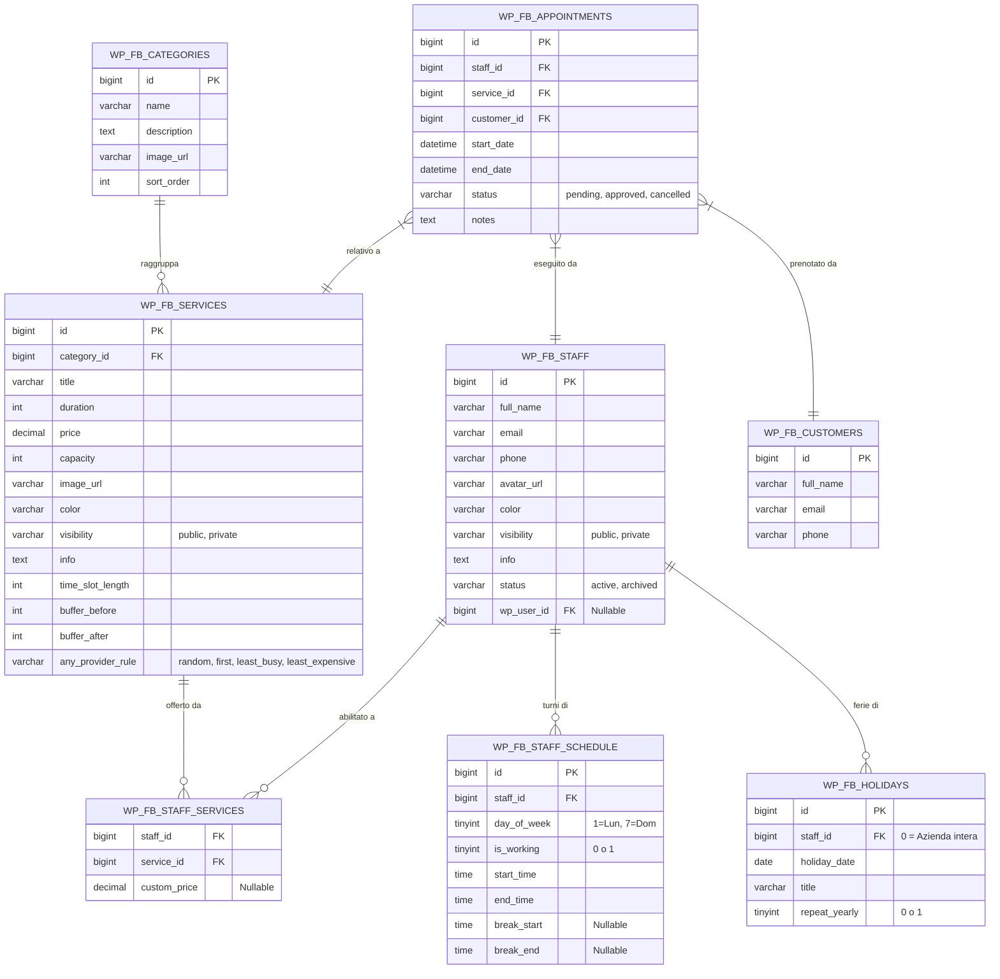

# Architettura "Free Bookly"

**Autore:** Stefano Lenzi  
**Licenza:** GPL-2.0+  
**Versione:** 1.2.0 (Open Source)

Questo documento descrive l'architettura tecnica del plugin, progettata secondo i principi di massima modularità, assenza di dipendenze pesanti, testabilità e parità funzionale completa con Bookly Pro.

---

## 1. Architettura Generale a Moduli (Core + Extensions)

Il plugin adotta un pattern MVC modulare integrato con WordPress Hooks:

---

## 2. Schema del Database Relazionale (DB Version 1.2.0)

Tutte le entità sono gestite con tabelle dedicate SQL, indicizzate per garantire velocità istantanea anche con centinaia di migliaia di appuntamenti:

---

## 3. Motore di Disponibilità & Collision Engine

La classe [`FB_Availability`](file:///c:/Users/stefy/Progetti/free-bookly/includes/class-fb-availability.php) esegue il calcolo in tempo reale secondo il seguente flusso:
1. **Controllo Festività (Holidays):**
   * Se la data è registrata come festività aziendale (`staff_id = 0`) o giorno di ferie del collaboratore, la giornata è considerata chiusa e restituisce 0 slot.
   * Supporta ricorrenza annuale automatica (`repeat_yearly = 1`).
2. **Turno di Lavoro & Pause (Schedules & Breaks):**
   * Recupera gli orari del collaboratore da `wp_fb_staff_schedule`.
   * Se non impostati, eredita automaticamente gli orari aziendali predefiniti (`FB_Settings::get_company_working_hours()`).
3. **Passo Temporale di Avanzamento (Time Slot Length):**
   * Determinato dal servizio (`time_slot_length`) oppure dall'impostazione globale (`fb_time_slot_length`, default 15 min).
4. **Verifica Collisioni con Buffer Times:**
   * Per ogni slot potenziale `[start, end]`:
     * Durata richiesta = `duration + buffer_after`.
     * Margine iniziale = `start - buffer_before`.
     * Verifica che l'intervallo non si sovrapponga a pause di turno o appuntamenti già confermati/in attesa.
5. **Regole Assegnazione "Qualsiasi Collaboratore" (Any Provider):**
   * `random`: Selezione casuale uniforme tra tutti i collaboratori liberi.
   * `first`: Primo collaboratore in ordine di apparizione.
   * `least_busy`: Collaboratore con minor numero di appuntamenti nella giornata prescelta (bilanciamento del carico).
   * `least_expensive`: Collaboratore che offre la tariffa più conveniente per il servizio.

---

## 4. Frontend Multi-Form & Vanilla JS Engine

Tutti i form sono serviti dal file [`public/js/free-bookly-wizard.js`](file:///c:/Users/stefy/Progetti/free-bookly/public/js/free-bookly-wizard.js), scritto in puro Vanilla JavaScript:
* **Classic Wizard:** Navigazione a schede progressiva con pre-filtro categorie e validazione input.
* **Services Catalog:** Griglia responsive a schede con filtraggio pillole e modale dinamico.
* **Staff-First:** Vetrina del personale con avatar, colori distintivi e apertura modale con collaboratore pre-assegnato.
* **Search Form:** Ricerca per data e fascia oraria (*Mattina*, *Pomeriggio*, *Sera*) con restituzione immediata degli slot.
