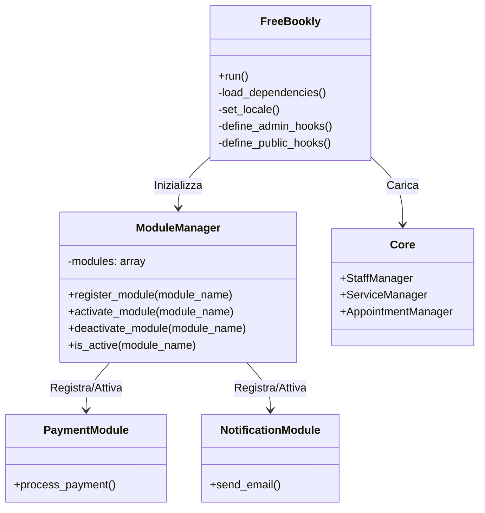
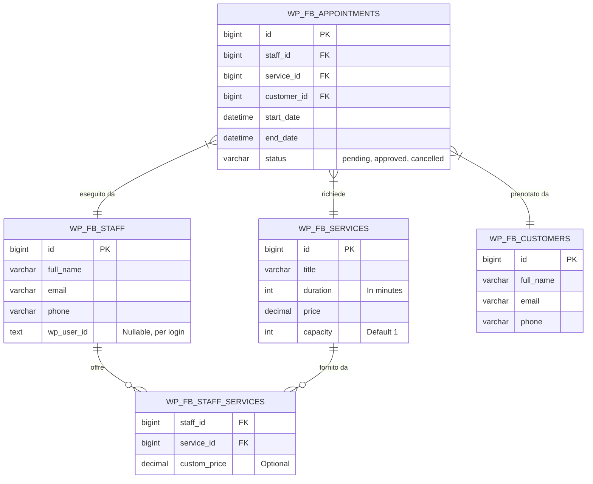

# Architettura "Free Bookly"

Questo documento descrive l'architettura base del plugin, progettata per essere modulare, performante e testabile.

## 1. Architettura a Moduli (Core + Extensions)

Il sistema adotta un design pattern basato su un gestore centrale di moduli (Module Manager).
Il `Core` fornisce API, interfacce e le strutture dati (Custom Tables). I `Moduli` si agganciano a queste API.

## 2. Schema del Database

Invece di usare `wp_posts` e `wp_postmeta`, usiamo tabelle custom per le entità principali per garantire query veloci e join ottimali per la ricerca della disponibilità.

## 3. Gestione della Disponibilità (Anti-Overbooking)

L'algoritmo di disponibilità esegue i seguenti step:
1. Trova gli orari di lavoro dello staff richiesto per il giorno specifico (escludendo le pause).
2. Estrae da `WP_FB_APPOINTMENTS` tutti gli appuntamenti nello stato `approved` o `pending` per quel giorno.
3. Se integrato, estrae gli eventi da Google Calendar.
4. Genera gli slot temporali liberi dividendo l'orario di lavoro per intervalli regolari (es. ogni 15 minuti) e scarta gli slot che si sovrappongono con gli impegni (Step 2 e 3).
