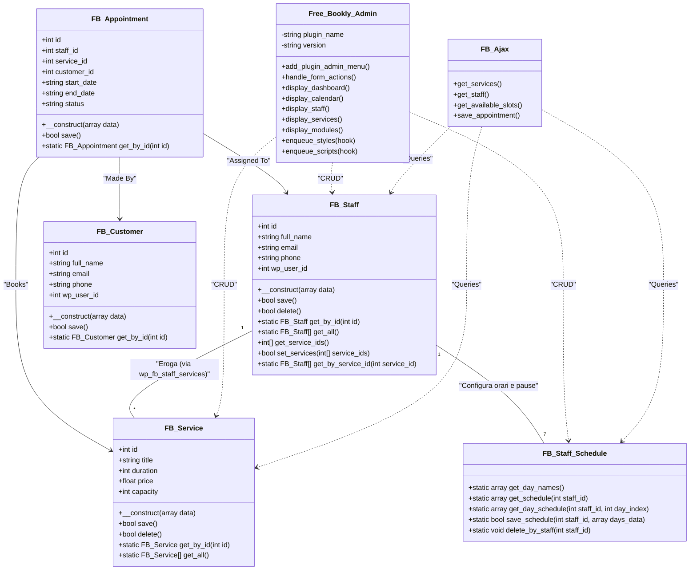

# Class Diagram: Modelli Core (CRUD)

**Autore:** Stefano Lenzi  
**Licenza:** GPL-2.0+  
**Versione:** 1.1.0 (Open Source)

I seguenti diagrammi UML descrivono la struttura delle classi che si occupano di interagire con il database per le entità principali del plugin Free Bookly.

